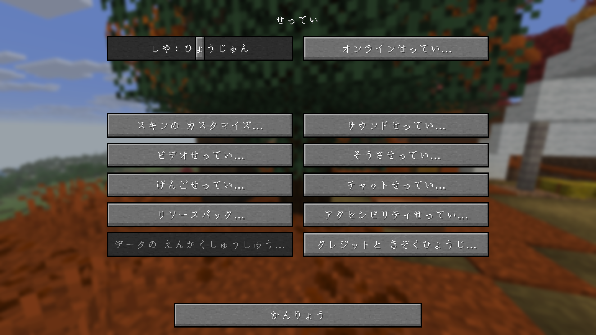
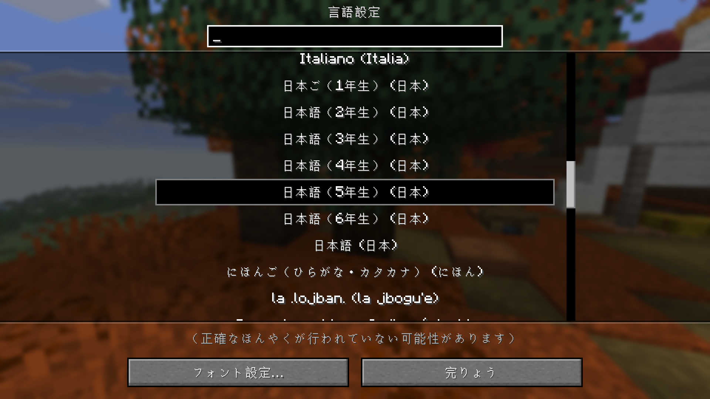
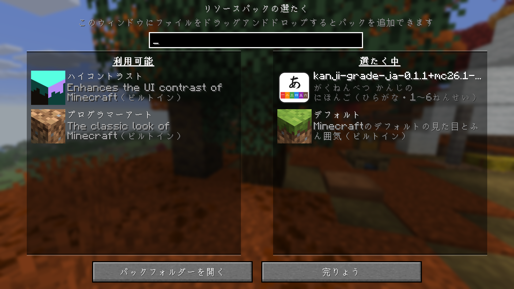

# Kanji Grade Language Pack

[English](README.md) | 日本語

Minecraft 公式の製品ではありません。Mojang・Microsoft が認めたものでも、関係するものでもありません。

NOT AN OFFICIAL MINECRAFT PRODUCT. NOT APPROVED BY OR ASSOCIATED WITH MOJANG OR MICROSOFT.

## どんなパックか

Minecraft Java 版の言語の一覧に、子ども向けの日本語を 7 つ足すリソースパックです。

| 言語コード | 一覧に出る名前 | 中身 |
|---|---|---|
| `ja_kana` | にほんご（ひらがな・カタカナ） | 漢字を使わない。文節の間に半角スペース |
| `ja_g1` | 日本ご（1年生） | 1 年生までに習う漢字だけを使う。文節の間に半角スペース |
| `ja_g2` | 日本語（2年生） | 2 年生までに習う漢字だけを使う。文節の間に半角スペース |
| `ja_g3`〜`ja_g6` | 日本語（3年生）〜日本語（6年生） | その学年までに習う漢字だけを使う |

言語の一覧では、名前の後ろに地域名（日本・にほん）が付きます。

- 学年は、文部科学省の学年別漢字配当表（2020 年度から、1026 字）によります。
- 1・2 年生の教科書と同じく、ひらがな・カタカナの言語と 1・2 年生の言語は、文節の間を空けて書きます（分かち書き）。
- 熟語の一部だけを習っていないときは、習った字を残します（教科書と同じ交ぜ書き）。
- 漢字は、常用漢字表に載っている読み（付表の熟字訓を含む）で使われているときだけ見せます。表に無い読みの字（当て字など）は、どの学年でもかなにします。

| ja_jp | ja_kana | ja_g1 | ja_g2 | ja_g3 | ja_g4 | ja_g5 | ja_g6 |
|---|---|---|---|---|---|---|---|
| 鉄格子 | てつごうし | てつごう子 | てつごう子 | 鉄ごう子 | 鉄ごう子 | 鉄格子 | 鉄格子 |
| 作業台 | さぎょうだい | さぎょうだい | 作ぎょう台 | 作業台 | 作業台 | 作業台 | 作業台 |
| 言語設定… | げんごせってい… | げんごせってい… | 言語せってい… | 言語せっ定… | 言語せっ定… | 言語設定… | 言語設定… |

### 画面

設定の画面（ひらがな・カタカナ、3 年生、6 年生）：

| ja_kana | ja_g3 | ja_g6 |
|---|---|---|
|  |  |  |

| 言語の一覧 | リソースパックの一覧 |
|---|---|
|  |  |

対応する版：Minecraft Java 版 26.1〜26.3

### 使い方

1. このリポジトリの Releases から、遊ぶ Minecraft の版に合う zip を取る（名前の `mc` の後ろが、その zip の対応する版の範囲です。例：`kanji-grade-ja-0.1.1+mc26.1-26.3.zip` は 26.1〜26.3）
2. zip を、Minecraft のフォルダの `resourcepacks` に入れる
3. 設定 → リソースパック で、このパックを有効にする
4. 設定 → 言語設定 で、7 つの言語から選ぶ（学年を変えるときは、ここで選び直す）

### 知っておくこと

- 変わるのは Minecraft 本体の文字列だけです。ほかの MOD の文字列は、その MOD がこれらの言語のファイル（`ja_kana.json`・`ja_g1.json`〜`ja_g6.json`）を持っていなければ英語で出ます。
- 読みは形態素解析で付けて、見直したものです。読みのまちがいが残っているかもしれません。
- 数字は数字のまま残すので、数字によって読みが変わる語（1日 ついたち、5日 いつか など）は、数字によらない読み（にち）にしています。
- 文節の区切り（分かち書きのスペース）は、品詞から機械的に決めています。「もしかして」が「もしか して」になるなど、不自然な所が残っています。

### まちがいを見つけたら

このリポジトリの Issues に書いてください。次の 4 つがあると直しやすくなります。

- 言語（例：日本語（3年生））と、Minecraft の版
- どの画面の、どの文字か（スクリーンショットがあれば、それも）
- 今の表示
- 正しい読みや区切り

### AI の使い方

このパックを作るプログラム、読みの直し、ドキュメントは、Anthropic の AI（Claude）と一緒に作りました。パックの中の文字列は、Minecraft の日本語の文字列をプログラムで機械的に置き換えたもので、AI が文を書いたものではありません。アイコンは、プログラムがフォントで描いたものです。

## 作り方

要るのは Docker と make（GNU Make 4.3 以上）だけです。ビルドとテストは全部コンテナの中で行います。

```sh
make                    # dist/kanji-grade-ja-<版>+mc<Minecraft の版の範囲>.zip を作る（例 kanji-grade-ja-0.1.1+mc26.1-26.3.zip）
make test               # Python のテスト
make game-client-tests  # 作ったパックを、対応する版ごとの Minecraft のクライアントで確かめる
```

1. `ja_jp.json` を Mojang から取る。取るのは `minecraft_versions.toml` に版ごとに書いた SHA-1 のファイルです（Mojang は版を出した後も訳を差し替えるため、SHA-1 で決めています）。同じ `ja_jp.json` の版どうしは 1 つのパックにまとめ、`pack.mcmeta` にはそれらの版のリソースパックの形式の範囲を書きます
2. Sudachi で語に分けて読みを付け、読みを字ごとに割り当てる（`build/ja_jp_reading_markup.<ja_jp.json の SHA-1>.json`）。読みの直しは `data/reading_fixes.toml`
3. 7 つの言語に書き出し、検査して、1 つの zip にする。マークアップを外すと原文に戻ること、その学年より上の漢字が無いこと、プレースホルダーや書式コードが原文と同じことなどを確かめ、1 つでも違えば zip を作りません

同じ入力からは、いつ作ってもバイト単位で同じ zip ができます。

| コマンド | すること |
|---|---|
| `make show-string KEY=<キー>` | 1 つの文字列の、原文・読みのマークアップ・7 つの言語 |
| `make game-client-test MINECRAFT_VERSION=<版>` | 1 つの版のクライアントで確かめる（省略すると最新の版） |
| `make update-minecraft-versions` | `minecraft_versions.toml` を Minecraft に合わせて書き換え（版の新しい `ja_jp.json`、Fabric API のある新しいリリース）、手ですることを示す |
| `make ja-jp-changes PREVIOUS_SHA1=<sha1> NEW_SHA1=<sha1>` | 新しい `ja_jp.json` で増えた・変わった文字列と、7 つの言語（`build/ja_jp_changes.md`） |
| `make served-ja-jp-sha1 MINECRAFT_VERSION=<版>` | その版に Mojang がいま出している `ja_jp.json` の SHA-1 |
| `make java-version MINECRAFT_VERSION=<版>` | その版が動く Java の版 |
| `make resource-pack-format MINECRAFT_VERSION=<版>` | その版のリソースパックの形式（クライアントの jar から読む） |
| `make fetch-kanji-data` | `data/grade_kanji_readings.json`（学年別の漢字と音訓）と `data/joyo_appendix_words.json`（付表の語）を、国の公開している PDF から作り直す |
| `make pack-icon` | アイコン `data/pack_icon.png` を描き直す |
| `make lock` | `pyproject.toml` を変えた後に `uv.lock` を作り直す |
| `make gradle-verification-metadata` | Fabric や Gradle の版を変えた後に、Gradle の依存のハッシュを記録し直す |
| `make pack-diff PREVIOUS=<zip> NEW=<zip>` | 2 つのパックで、言語ごとに違う文字列（`build/pack_diff.md`） |
| `make github-settings` | GitHub のリポジトリの設定を当て直す（gh を使う） |

### 読みを直すには

`make show-string KEY=<キー>` で文字列の読みを見て、`data/reading_fixes.toml` に規則を足します。規則は、語と Sudachi の読みに、前後の語や文字列のキーなどの条件を付けて書きます（書き方はファイルの先頭と `src/kanji_grade_language_pack/reading_fixes.py`）。どの語にも当たらない規則があると、ビルドが止まります。

### 構成

| パス | 中身 |
|---|---|
| `minecraft_versions.toml` | 対応する Minecraft の版：版ごとのリソースパックの形式、`ja_jp.json` の SHA-1、動かす Java の版、テストに使う Fabric API |
| `versions.mk` | パックの版、Fabric Loader と Loom の版、アイコンのフォント |
| `src/kanji_grade_language_pack/` | ビルドのプログラム（`python -m kanji_grade_language_pack`） |
| `tests/` | Python のテスト（pytest） |
| `data/` | 学年別の漢字、付表の語、読みの直し、アイコン |
| `game_client_test/` | Minecraft のクライアントで確かめるテスト用の MOD（Fabric の client GameTest）。`docker/java<N>/` は Java の版ごとのテスト用のイメージ |
| `pyproject.toml`・`uv.lock` | Python の依存（ハッシュで固定） |
| `screenshots/` | この README の画面。ゲームでのテストが撮ったもの（`game_client_test/run/<版>/screenshots/`） |

### GitHub Actions

- `build.yml`：PR のたびに（マージの前に）、テスト、パックの作成、再現性の確認を行い、対応する版ごとにゲームで確かめ、スクリーンショットを artifact に残します。`main` には、これが通った PR だけが入ります。手で動かしたときは、zip も artifact に残します。
- `check-minecraft-versions.yml`：毎日、Minecraft と Fabric の新しいもの（新しいリリース、新しい `ja_jp.json`、Fabric の新しいビルド）を調べ、実行のまとめに書きます。することがあるときは、通知が届くように実行を失敗で終わらせます。新しい版への追従は、`make update-minecraft-versions` から手で行います。
- `release.yml`：`PACK_VERSION`（`versions.mk`）を上げた変更が `main` に入ると、テストとパックの作成をし（ゲームでのテストは PR で済んでいる）、承認の後にタグ `v<PACK_VERSION>` と GitHub Release を作り、zip を付けます。リポジトリの変数 `MODRINTH_PROJECT_ID` とシークレット `MODRINTH_TOKEN` があれば、Modrinth にもパックごとに公開します（mc-publish）。

## データの出典

- 学年：文部科学省「[音訓の小・中・高等学校段階別割り振り表](https://www.mext.go.jp/a_menu/shotou/new-cs/1385768.htm)」（2017 年 3 月）。学年別漢字配当表（小学校学習指導要領、2017 年告示）の学年が載っている
- 音訓と付表：文化庁「[常用漢字表](https://www.bunka.go.jp/kokugo_nihongo/sisaku/joho/joho/kijun/naikaku/kanji/)」（2010 年内閣告示）
- 元の文字列：Minecraft の `ja_jp.json`（Mojang）。このリポジトリには入っていない

## ライセンス

このリポジトリのプログラム・データ・アイコンは MIT License です（`LICENSE`）。

作ったパックの中の文字列は、Minecraft の日本語の文字列（Mojang のもの）を置き換えたもので、MIT License の対象ではありません。

使っているソフトウェア：[SudachiPy・SudachiDict](https://github.com/WorksApplications/sudachi.rs)（Apache License 2.0）、[pypdf](https://github.com/py-pdf/pypdf)（BSD 3-Clause）、[Pillow](https://github.com/python-pillow/Pillow)（MIT-CMU）、[pytest](https://github.com/pytest-dev/pytest)（MIT）。アイコンのフォントは [Yuji Syuku](https://github.com/Kinutafontfactory/Yuji)（SIL Open Font License 1.1）で、パックに入るのは描いた画像だけです。
