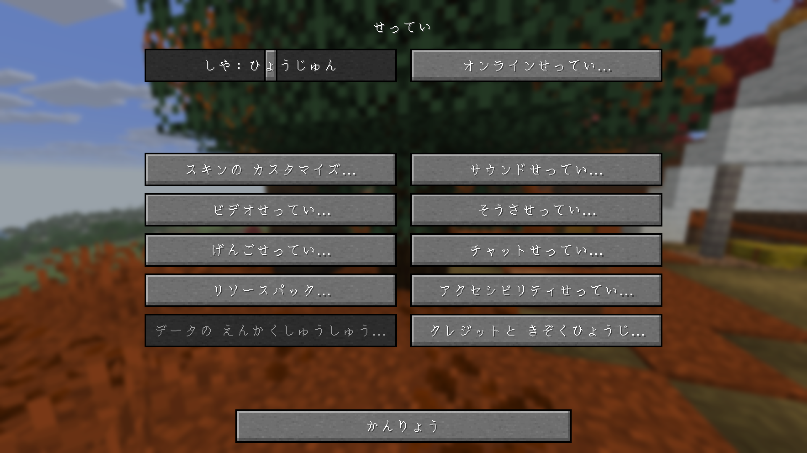
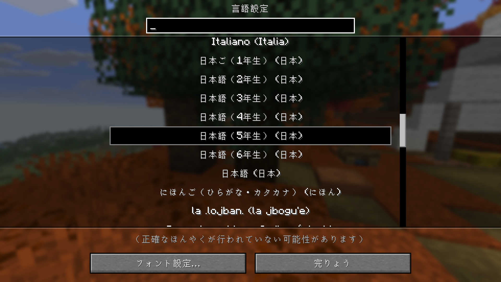
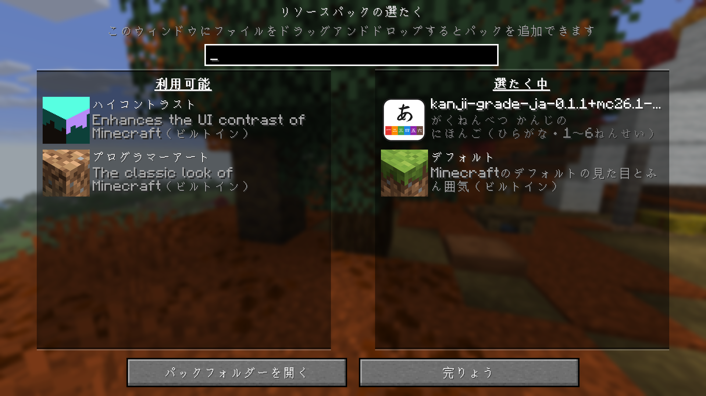

# Kanji Grade Language Pack

English | [日本語](README.ja.md)

A resource pack for Minecraft: Java Edition that adds seven Japanese languages for children. Six of them keep only the
kanji taught up to a school grade in Japan (grades 1 to 6) and write the other words in hiragana; the seventh uses
hiragana and katakana only. The vanilla Japanese (`ja_jp`) is left as it is.

This repository holds the program that builds the pack from the game's own Japanese strings. The pack itself is not
stored here: it is built from the `ja_jp.json` that Mojang serves. The built packs are on the Releases of this
repository.

NOT AN OFFICIAL MINECRAFT PRODUCT. NOT APPROVED BY OR ASSOCIATED WITH MOJANG OR MICROSOFT.

## The pack

| Language code | Name in the list | What it shows |
|---|---|---|
| `ja_kana` | にほんご（ひらがな・カタカナ） | No kanji. A space between phrases |
| `ja_g1` | 日本ご（1年生） | Only the kanji of grade 1. A space between phrases |
| `ja_g2` | 日本語（2年生） | Only the kanji up to grade 2. A space between phrases |
| `ja_g3`–`ja_g6` | 日本語（3年生）–日本語（6年生） | Only the kanji up to that grade |

In the language list, the region (日本・にほん) follows each name.

- The grades are those of the list of kanji by grade of the Ministry of Education (MEXT), in use since 2020 (1,026
  kanji).
- Like the textbooks of grades 1 and 2, the kana-only language and grades 1 and 2 put a space between phrases
  (分かち書き).
- When a word has a kanji not yet taught, only that kanji becomes kana; the ones already taught stay (交ぜ書き, as
  textbooks do).
- A kanji is shown only where it is used with a reading of the Jōyō kanji table (including the special readings of its
  appendix). A kanji used with a reading the table does not have (ateji, for example) is always kana, in every grade.

| ja_jp | ja_kana | ja_g1 | ja_g2 | ja_g3 | ja_g4 | ja_g5 | ja_g6 |
|---|---|---|---|---|---|---|---|
| 鉄格子 | てつごうし | てつごう子 | てつごう子 | 鉄ごう子 | 鉄ごう子 | 鉄格子 | 鉄格子 |
| 作業台 | さぎょうだい | さぎょうだい | 作ぎょう台 | 作業台 | 作業台 | 作業台 | 作業台 |
| 言語設定… | げんごせってい… | げんごせってい… | 言語せってい… | 言語せっ定… | 言語せっ定… | 言語設定… | 言語設定… |

### Screenshots

The options screen in the kana-only language, grade 3 and grade 6:

| ja_kana | ja_g3 | ja_g6 |
|---|---|---|
|  |  |  |

| The language list | The resource pack list |
|---|---|
|  |  |

Supported versions: Minecraft: Java Edition 26.1–26.3

### How to use

1. Download the zip for your Minecraft version from the Releases of this repository. The part after `mc` in its name
   is the range of versions it is for: `kanji-grade-ja-0.2.1+mc26.1-26.3.zip` is for 26.1 to 26.3.
2. Put the zip in the `resourcepacks` folder of Minecraft.
3. Turn the pack on in Options → Resource Packs.
4. Choose one of the seven languages in Options → Language (to change the grade, choose again there).

### Good to know

- Only the strings of Minecraft itself change. Other mods show their own strings in English unless they have files for
  these languages (`ja_kana.json`, `ja_g1.json` to `ja_g6.json`).
- The readings come from a morphological analyzer and have been reviewed. Some wrong readings may remain.
- Numbers stay as digits, so words whose reading depends on the number (1日 ついたち, 5日 いつか) get the reading
  that does not (にち).
- The spaces between phrases are placed by rules on the parts of speech. Some are unnatural (もしかして becomes
  もしか して, for example).

### Found a mistake?

Please open an issue in this repository. These four make it easy to fix:

- the language (for example 日本語（3年生）) and the Minecraft version
- which screen and which text (a screenshot helps)
- what it shows now
- the right reading or spacing

### How AI was used

The program that builds the pack, the reading fixes and the documents were made with Anthropic's AI, Claude. The
strings in the pack are Minecraft's Japanese strings, rewritten by the program; no sentence in them was written by AI.
The icon is drawn by the program with a font.

## Building

You need only Docker and make (GNU Make 4.3 or later). Everything is built and tested in containers.

```sh
make                    # dist/kanji-grade-ja-<version>+mc<range of Minecraft versions>.zip (e.g. kanji-grade-ja-0.2.1+mc26.1-26.3.zip)
make test               # the Python tests
make game-client-tests  # checks the pack in the Minecraft client of each supported version
```

1. Get `ja_jp.json` from Mojang: the file of the SHA-1 written for each version in `minecraft_versions.toml` (Mojang
   replaces translations after a release, so the SHA-1 decides which one). Versions with the same `ja_jp.json` share
   one pack, whose `pack.mcmeta` has the range of their resource pack formats.
2. Split the strings into words and read them with Sudachi, then give each kanji its part of the reading
   (`build/ja_jp_reading_markup.<SHA-1 of ja_jp.json>.json`). Fixes of readings are in `data/reading_fixes.toml`.
3. Write the seven languages, check them, and put them in one zip. The checks: removing the markup gives back the
   original, no kanji is above the grade, placeholders and formatting codes are the same as the original, and so on.
   If any fails, no zip is made.

The same input always gives the same zip, byte for byte.

| Command | What it does |
|---|---|
| `make show-string KEY=<key>` | One string: the original, its reading markup and the seven languages |
| `make game-client-test MINECRAFT_VERSION=<version>` | Checks the pack in the client of one version (the newest when left out) |
| `make update-minecraft-versions` | Brings `minecraft_versions.toml` up to Minecraft (a new `ja_jp.json` of a version, a new release that has a Fabric API) and lists what is left to do by hand |
| `make ja-jp-changes PREVIOUS_SHA1=<sha1> NEW_SHA1=<sha1>` | The strings a new `ja_jp.json` adds or changes, with the seven languages (`build/ja_jp_changes.md`) |
| `make served-ja-jp-sha1 MINECRAFT_VERSION=<version>` | The SHA-1 of the `ja_jp.json` Mojang serves for that version now |
| `make java-version MINECRAFT_VERSION=<version>` | The Java version that version runs on |
| `make resource-pack-format MINECRAFT_VERSION=<version>` | The resource pack format of that version (read from the client jar) |
| `make fetch-kanji-data` | Builds `data/grade_kanji_readings.json` (kanji by grade, with their readings) and `data/joyo_appendix_words.json` (the words of the appendix) again from the government's PDFs |
| `make pack-icon` | Draws the icon `data/pack_icon.png` again |
| `make lock` | Makes `uv.lock` again after a change of `pyproject.toml` |
| `make gradle-verification-metadata` | Records the hashes of the Gradle dependencies again after a change of the Fabric or Gradle versions |
| `make pack-diff PREVIOUS=<zip> NEW=<zip>` | The strings that differ between two packs, per language (`build/pack_diff.md`) |
| `make github-settings` | Applies the settings of the GitHub repository again (with gh) |

### Fixing a reading

Look at the reading of a string with `make show-string KEY=<key>` and add a rule to `data/reading_fixes.toml`. A rule
names a word and Sudachi's reading of it, with conditions such as the words before and after it or the key of the
string (see the top of the file and `src/kanji_grade_language_pack/reading_fixes.py`). A rule that matches no word
stops the build.

### Layout

| Path | What it holds |
|---|---|
| `minecraft_versions.toml` | The supported Minecraft versions: the resource pack format, the SHA-1 of `ja_jp.json`, the Java version and the Fabric API of the test, for each version |
| `versions.mk` | The pack version, the Fabric Loader and Loom versions, the icon font |
| `src/kanji_grade_language_pack/` | The program (`python -m kanji_grade_language_pack`) |
| `tests/` | The Python tests (pytest) |
| `data/` | The kanji by grade, the words of the appendix, the reading fixes, the icon |
| `game_client_test/` | The mod that checks the pack in the Minecraft client (a Fabric client GameTest). `docker/java<N>/` holds the test image of each Java version |
| `pyproject.toml`, `uv.lock` | The Python dependencies (pinned by hash) |
| `screenshots/` | The screenshots of this README, taken by the client test (`game_client_test/run/<version>/screenshots/`) |

### GitHub Actions

- `build.yml`: on every pull request (before it is merged), runs the tests, builds the pack, checks it is
  reproducible, checks it in the game for each supported version, and keeps the screenshots as artifacts; `main`
  takes only pull requests whose checks passed. Run by hand, it also keeps the zip as an artifact.
- `gradle-dependency-cache.yml`: keeps the Gradle dependencies of the client tests in a cache of `main`, which the
  client tests of pull requests restore instead of downloading them again.
- `check-minecraft-versions.yml`: every day, looks for what is new in Minecraft and Fabric (new releases, new
  `ja_jp.json` files, new builds of Fabric) and writes it in the summary of the run. When there is something to do, the
  run fails so that a notice is sent; following a new version is done by hand, starting with
  `make update-minecraft-versions`.
- `release.yml`: a push to `main` that raises `PACK_VERSION` (`versions.mk`) releases it: runs the tests, builds the
  packs and, after approval, makes the tag `v<PACK_VERSION>` and a GitHub Release with the zips (the client tests
  passed on the pull request). With the
  repository variable `MODRINTH_PROJECT_ID` and the secret `MODRINTH_TOKEN`, each pack is also published on Modrinth
  (mc-publish).

## Sources of the data

- Grades: MEXT, "[音訓の小・中・高等学校段階別割り振り表](https://www.mext.go.jp/a_menu/shotou/new-cs/1385768.htm)"
  (March 2017), which gives the grades of the list of kanji by grade (Course of Study for elementary schools, 2017)
- Readings and the appendix: Agency for Cultural Affairs,
  "[常用漢字表](https://www.bunka.go.jp/kokugo_nihongo/sisaku/joho/joho/kijun/naikaku/kanji/)" (Cabinet notice, 2010)
- The original strings: Minecraft's `ja_jp.json` (Mojang), not in this repository

## License

The program, the data and the icon of this repository are under the MIT License (`LICENSE`).

The strings in the built pack are Minecraft's Japanese strings (Mojang's), rewritten; they are not under the MIT
License.

Software used: [SudachiPy and SudachiDict](https://github.com/WorksApplications/sudachi.rs) (Apache License 2.0),
[pypdf](https://github.com/py-pdf/pypdf) (BSD 3-Clause), [Pillow](https://github.com/python-pillow/Pillow) (MIT-CMU),
[pytest](https://github.com/pytest-dev/pytest) (MIT). The icon font is [Yuji Syuku](https://github.com/Kinutafontfactory/Yuji)
(SIL Open Font License 1.1); only the drawn image is in the pack.
